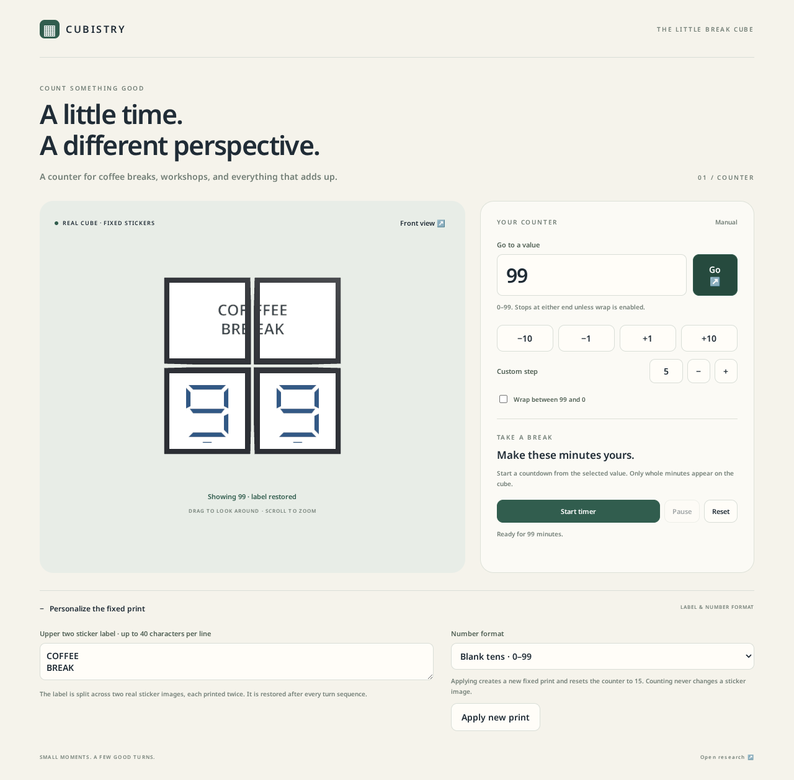

# Cubistry

A browser-first twisty-puzzle platform. The first local MVP is a **real fixed-print
2×2 counter**: two constant upper title stickers and two lower digits, 0–99.

## Architecture and ecosystem

Cubistry is the reusable cube-display framework between the
[PuzlWerk](https://github.com/wstein/puzlwerk) puzzle/solver foundation and
application-level products. Dependencies flow from applications to Cubistry to
PuzlWerk, never in reverse.

Cubistry owns generic physical-display composition, the 3D viewer and animator,
rendering of permanent sticker prints, validation, and a planned declarative
application runtime. Its viewer is a reusable module within this monorepo, not
a separate repository; a future print/design studio will *use* the viewer,
not be required by it.

The neutral 00–99 counter belongs in Cubistry as a reference example. The
planned **ChronoCube** application belongs above the framework and focuses
strictly on time-related uses (clocks, calendars, countdowns). Its application
definitions, physical print designs, visual themes, and certified transition
data should remain separable, with as little application-specific code as
practical. Changing the appearance of a screen-only theme should not change
physical state semantics; changing physical sticker art or placement requires
appropriate revalidation.

This describes the intended architectural boundary. The current counter is
an MVP, not evidence that the full declarative runtime, ChronoCube, or studio
has already been delivered. Cubistry must remain usable without ChronoCube.

## Development preview

Expected Pages URL: https://wstein.github.io/cubistry/. Publication awaits the
first human-approved merge and successful main-only Pages workflow; this link
is not a claim that the preview is already online. The static counter needs no
dev server. The existing solver acceptance page remains development-only.

This MVP preview is separate from the selective Hugo/documentation roadmap in
[issue #10](https://github.com/wstein/cubistry/issues/10); it does not publish the
knowledge tree. Reproduce the project-path build with
`VITE_BASE_PATH=/cubistry/ npm run build` and `npm run test:pages`.

## Run the counter locally

Requires Node 24+ (tested with 24.19.0), npm, Git, and Python 3 for proof checks.

```sh
npm run setup
npm run dev
```

Open `http://localhost:5173` on the same computer (keep Vite's current port if
it differs). Print IDs and asset integrity require Web Crypto; remote/LAN
clients need HTTPS because plain HTTP on an IP address does not expose it.

The shared chooser in the header offers **Counter 0–99**, starting at 00 with the
certified print. **Set** moves directly to the target; **Run** counts toward it
by one per second, automatically choosing up or down. Editing the input alone
does not change a running target. Set or a manual step interrupts Run. **Stop**
finishes the active complete physical value. Slow animation delays progression
instead of skipping values. Reload restores the last completed value without
restarting Run.

Manual −10/−1/+1/+10 actions clamp at the bounds unless **Wrap 99 ↔ 0** is
checked. Run always follows the direct numeric route, regardless of Wrap.
**Leading Zero** only shows or hides the leading 0 in the existing optimized
layout. It never selects a legacy print or resets the value, physical state,
Run, move counters, or camera. Both checkbox states use the same certified
339-HTM traversal. The unchecked option is screen formatting; the permanent
print/sticker identities remain unchanged.

Drag to orbit and scroll to zoom. **Rotation Speed** has six stops: 2 s, 1 s,
500 ms, 250 ms, 100 ms (default), and 50 ms per HTM move. It changes animation
only. The same **Run** button changes to **Stop** in place while work is active.
Current state, session moves, the current move sequence, and **Reset session
moves** are always visible together below the cube, above Rotation Speed.
The 60-minute
timer remains a future independent application under
[issue #30](https://github.com/wstein/cubistry/issues/30). See
[cube-first controls and verification](docs/CUBE_FIRST_UI.md).

The [certified route](docs/COUNTER_CERTIFIED_TRAVERSAL.md) retains 339 committed
HTM over 99 adjacent increments, maximum five per edge, excluding setup.
[Exact-frame arbitrary-jump planning](docs/COUNTER_ARBITRARY_JUMPS.md) reuses the
same shared solver while correcting coordinate-frame bias; it does not claim
global exactPhysical optimality or an arbitrary-path 339-HTM bound.

## Shared framework path

The counter is the first consumer of **PuzlWerk**: actual private shared workspaces
with a ReScript-owned domain/mechanics/validation/JSON codec and a TypeScript
viewer/browser asset loader. The canonical naming/language decision is
[issue #21](https://github.com/wstein/cubistry/issues/21); the hosted
repository is [PuzlWerk](https://github.com/wstein/puzlwerk), with the
`@puzlwerk/*` scope used for shared-package naming. No package publication or
broader core migration is implied; the existing `@cubistry/*` workspaces stay unchanged.
The counter now consumes the pinned private `@puzlwerk/solver-2x2` package in
`exactPhysical` mode; see [dependency setup and verification](docs/COUNTER_SHARED_SOLVER.md). [M1 contracts and data flow](docs/SHARED_CUBE_M1.md)
document the validated v2 design, loadable oriented images, independent replay,
and the explicit size-2 limits. Sizes 3–7 and external migrations remain planned.

## Evidence and checks

```sh
npm run typecheck
npm test
npm run test:proof
python3 research/counter/verify.py
python3 research/architecture/verify_design.py
npm run build
npx playwright install chromium
npm run test:e2e
```

In a cloud sandbox with an unwritable home cache, use
`npm_config_cache=/tmp/cubistry-npm-cache npm run setup` and set
`PLAYWRIGHT_BROWSERS_PATH=/tmp/cubistry-playwright` for browser installation/tests.

[The independent feasibility proof](docs/COUNTER_FEASIBILITY.md) establishes
both padded and unpadded fixed prints as SAT, and permanently fixed upper cubies
as UNSAT under the distinct-upright-glyph model. [The reuse audit](docs/COUNTER_REUSE.md)
records existing renderer/solver choices, licenses, and sizes. The
[knowledge base](knowledge/Home.md) preserves product concepts and findings.

The UI uses actual image stickers on eight rigid corner cubies. Title text is
not a front-face HTML overlay. Solver-generated move words are independently
replayed. Transitions now solve from the actual complete physical state directly
to the selected complete target, including exact print orientation. The shared
solver plus any frame correction is not claimed HTM-optimal. No deployment is required.

## Preview



[Mobile preview](docs/assets/counter-mobile.png). These are browser screenshots,
not print exports; their pixel dimensions and hashes are
[recorded separately](docs/assets/counter-previews.json).

## Focused M1 acceptance examples

[Live existing-solver acceptance and independent library use](docs/M1_ACCEPTANCE.md)
cover issue #21's five-point DoD. With `npm run dev`, open
`/solver-acceptance.html` to compute fresh paths for fixed representative goals,
or `/library-example.html` for a standalone consumer with its own image/text
print and no counter modules. The live solver harness is development-only;
the regular counter uses the shared direct solver. The witness catalog still
defines complete targets and initial states, not transition detours.

The counter reports committed / planned HTM moves during playback.
[Move progress and Stop after this value](docs/COUNTER_MOVE_PROGRESS.md) document
queue/reset behavior and the existing non-optimal reference-state route.

## Physical sticker sheets

The separate Print stickers page provides compact vector print/cut PDFs for the
selected calendars and HSM lettering variants. Example dimensions must be
checked on the actual cube before ordering. See the
[print/export contract](docs/PRINT_STICKERS.md) for source-face assembly maps,
cut contours, licenses and reproducible custom-size exports.
