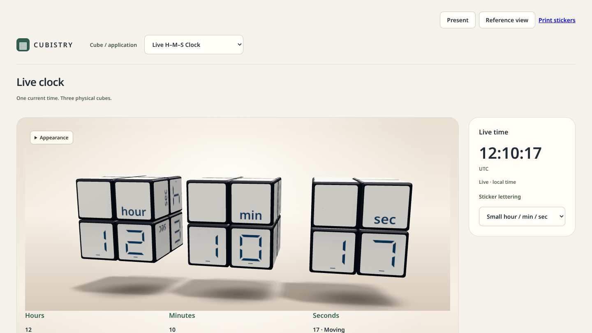

# Cubistry

Cubistry is a browser-first platform for twisty-puzzle displays: screens made of
real cubes that show numbers, time or status using only legal moves.

<p align="center">
  
</p>

*The Live H-M-S Clock, captured from this repository's `clock.html`
([provenance](docs/assets/readme/README.md)).* Three physical 2x2 cubes show the
hours, minutes and seconds of the current time. Each cube keeps its own physical
state, and every change of the display is a sequence of legal
face turns, never a redrawn sticker.

Quick links: [Try it](#try-it) | [Run it locally](#run-it-locally) |
[Learn more](#learn-more)

## What is this?

A cube display is a puzzle cube whose sticker pattern is chosen so that its
reachable states spell out values. Its print is the fixed set of stickers glued
to the cube; the display changes only by turning faces. Cubistry's rule is that
every display must be physically realizable, not merely look plausible on a
screen.

Cubistry provides the 3D viewer and animator, the sticker print rendering and
validation, and several reference applications. The solver foundation lives in the neighboring
[PuzlWerk](https://github.com/wstein/puzlwerk) project; feasibility research and
proof checkers live here under `research/` and `proof-checkers/`, with long-running
research on a dedicated branch. This repository keeps verified facts apart
from proposals: feasibility results are stated as `SAT` (a validated witness),
`UNSAT` (an independently checkable proof under explicit assumptions) or
`UNKNOWN` (anything else). See [Evidence and checks](docs/EVIDENCE_AND_CHECKS.md).

The current applications are working prototypes, not evidence that the planned
declarative runtime, the ChronoCube product or a print/design studio exists yet.

## Try it

The live site is https://wstein.github.io/cubistry/ (checked 2026-11-01; see
[Applications](docs/APPLICATIONS.md#development-preview)). Locally, the
application chooser in the page header switches between these:

| Application | What it shows | Entry point |
| --- | --- | --- |
| Live H-M-S Clock | Current time on three cubes | `clock.html` ([docs](docs/LIVE_CLOCK.md)) |
| Counter 0-99 | A two-digit counter (default page) | `index.html` ([docs](docs/COUNTER_USAGE.md)) |
| H/M/S Counter 00-59 | Seconds, minutes or hours | `index.html` ([docs](docs/HSM_COUNTER.md)) |
| 60-Minute and 5-Second Timers | Countdown and stopwatch | `index.html` ([docs](docs/WORKSHOP_TIMER.md), [docs](docs/FIVE_SECOND_TIMER.md)) |
| Calendar | German and English calendar cubes | `calendar.html` ([docs](docs/CALENDAR_CUBES.md)) |
| CI Quality Cube | Workflow status on six faces | `status.html` ([docs](docs/STATUS_CUBE.md)) |
| Picture Puzzle Playground | Free-play 2x2 with picture stickers | `playground.html` ([docs](docs/PICTURE_PLAYGROUND.md)) |

More pages, including sticker sheet export, are listed in
[Applications](docs/APPLICATIONS.md).

## Run it locally

Requires Node 24 or newer, npm, Git, and Python 3 for the proof checks.

```sh
npm run setup   # prepares the pinned solver packages, installs dependencies
npm run dev     # builds the ReScript core, starts Vite on http://localhost:5173
```

Open `http://localhost:5173/clock.html` for the live clock. Remote or LAN clients
need HTTPS because print and asset checks use Web Crypto. Test commands, sandbox
notes and the full list are in [Development](docs/DEVELOPMENT.md) and
[Evidence and checks](docs/EVIDENCE_AND_CHECKS.md).

## How the repository fits together

```text
applications (ChronoCube, clock, counters, ...)
        |  depend on
   Cubistry   viewer, animator, sticker prints, validation
        |  depends on
   PuzlWerk   puzzle and solver foundation (separate repository)
```

Dependencies flow downward only; Cubistry remains usable without ChronoCube.
Proof work lives on the protected branch `research/cube-display-feasibility`;
foundational design changes go on feature branches. The `knowledge/` directory is
a Markdown vault (decisions, specifications, findings): start at
[knowledge/Home.md](knowledge/Home.md). Details: [Architecture](docs/ARCHITECTURE.md).

## Checks and evidence

```sh
npm run typecheck
npm test
npm run build
```

Proofs count as confirmed only when both the Flix and the Julia checker accept
them; see [proof-checkers/AUTHORITY.md](proof-checkers/AUTHORITY.md). The
remaining commands (end-to-end tests, proof verifiers) are in
[Evidence and checks](docs/EVIDENCE_AND_CHECKS.md).

## Learn more

- [Architecture](docs/ARCHITECTURE.md) and [framework roadmap](docs/FRAMEWORK_ROADMAP.md)
- [Applications](docs/APPLICATIONS.md), [counter usage](docs/COUNTER_USAGE.md), [live clock](docs/LIVE_CLOCK.md)
- [Development](docs/DEVELOPMENT.md) and [evidence and checks](docs/EVIDENCE_AND_CHECKS.md)
- [Print stickers](docs/PRINT_STICKERS.md) for physical sticker sheets

## Contributing

Read [AGENTS.md](AGENTS.md) and [CONTRIBUTING.md](CONTRIBUTING.md): small
Conventional Commits, a linear `main`, and, for agent-authored work, an
independent author/reviewer workflow. Documentation is written in US English.
