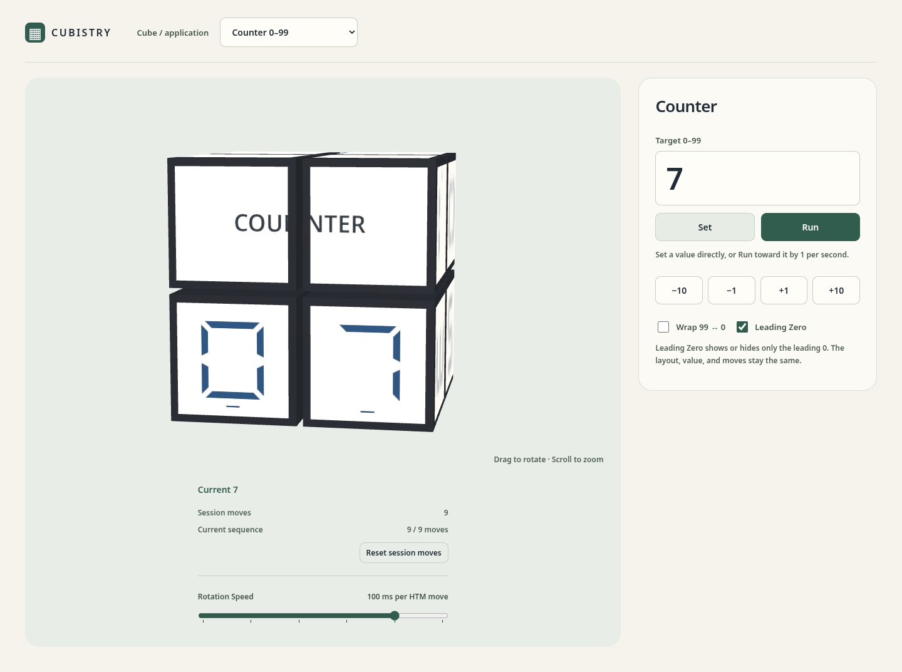
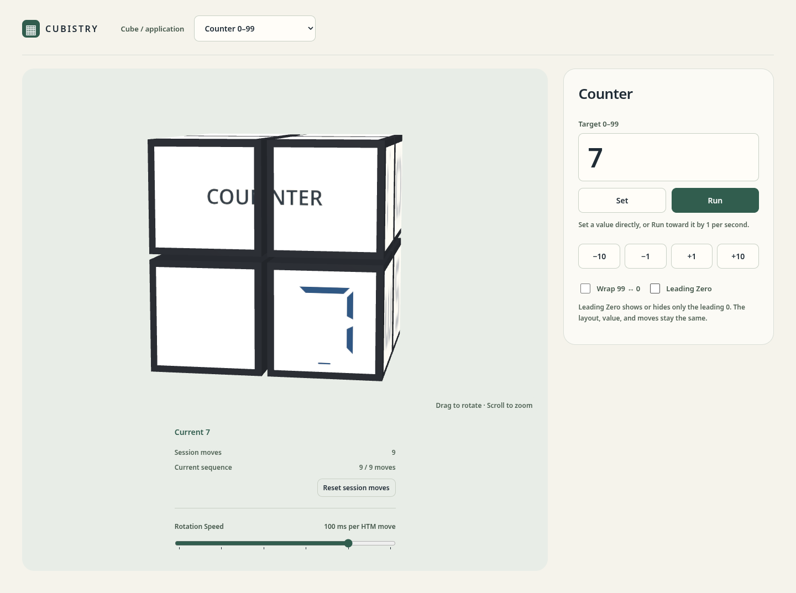
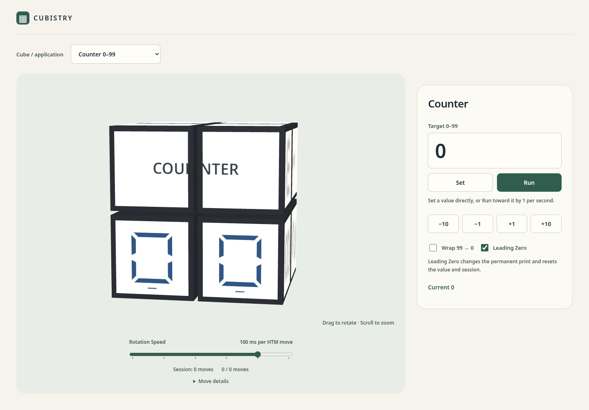
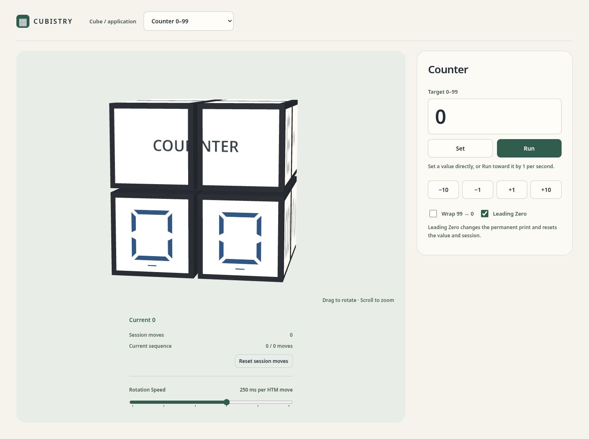
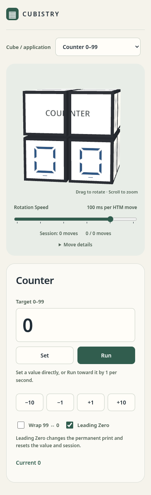
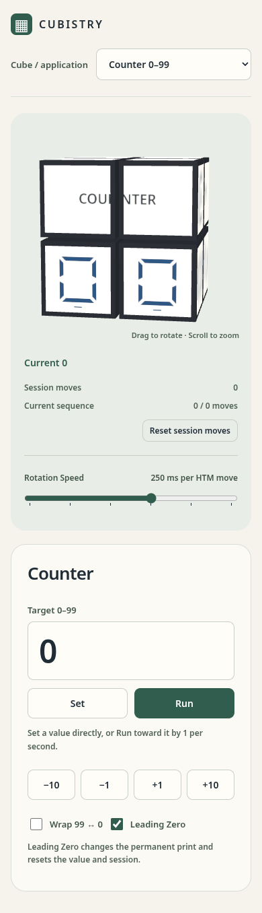
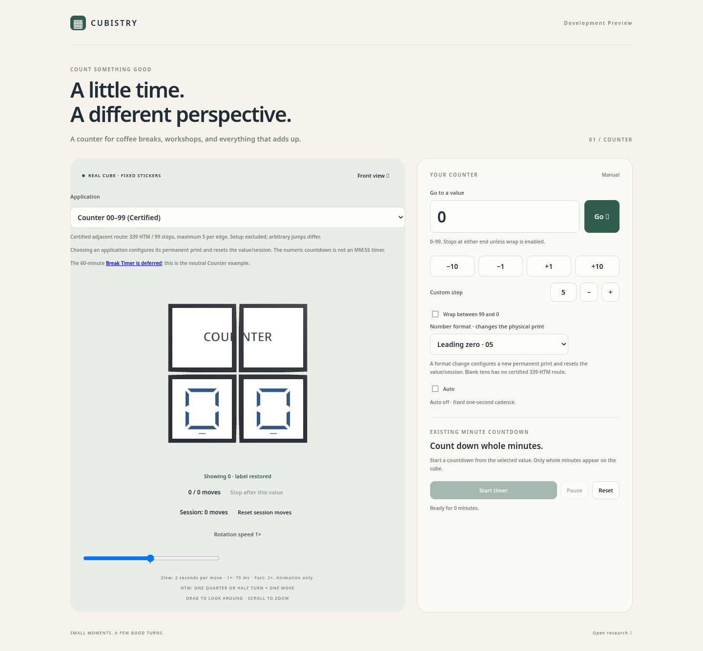
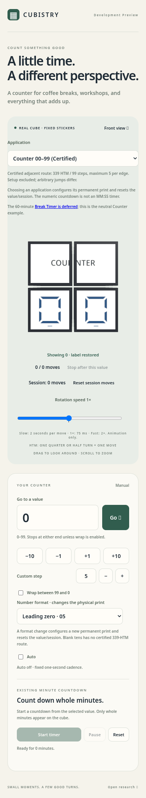

# Cube-first counter UI

[Issue #53](https://github.com/wstein/cubistry/issues/53) defines this change.
It starts from `76415c48600c61c2cb41e0f839f138b404ce8f64` on `main`, independently
of [PR #52](https://github.com/wstein/cubistry/pull/52). During implementation,
#52 merged into main; the feature rebased cleanly onto `5ba6109e628ebd93825cd5a5bd8a0c9a92d42846`. No unmerged
#52 branch was used as a development base.

## Interaction contract

Set requests the complete target state through the existing controller. Run
captures a numeric target and requests only the next adjacent value, at most
once per second and only after physical completion. It does not reconcile a
slow or suspended tab by jumping over values. Animation duration is separate
from this cadence. Editing the target during Run leaves the captured target
unchanged; Set or manual steps interrupt Run. A changed numeric target finishes
only the current turn before replanning from its actual full pose, as described
in [target interruption](TARGET_INTERRUPTION.md). Stop discards queued goals and
finishes the active complete value, preserving every required legal move.
A reload restores the last completed value and physical format, never a running
operation. Former minute-timer/Auto persistence does not resume hidden work.
The old timer and Auto modules and their unit regressions remain in the repository.

On the **COUNTER title** print (the default), Leading Zero is presentation-only,
as described here. On the [blank-top print variant](COUNTER_BLANK_TOP.md) it
selects the physical LZ or NZ mode instead and is labeled *Leading zero mode
(physical)*, with an explicit switch at 0 (6 setup moves, outside the session
count) or a zero-move switch at 31–99; Wrap defaults to on there. See that page.
On the titled print, both checkbox states configure the same
optimized permanent print and canonical states with the existing certified
route. OFF replaces only the leading field's rendered zero image with the
preloaded blank image; units zero and every other glyph/field/position remain
unchanged. No print definition, asset identity, geometry, physical state,
solver goal, move sequence, progress, Run/Set, counters, or camera is reset.
The checkbox remains available during operations and persists on reload.
Reload retains existing restore semantics: it reconstructs the saved value on
the same optimized layout, without promising session/camera persistence or
resuming Run. Legacy library/proof support remains separately testable and is
not exposed through the normal counter checkbox.

The generic viewer's conditional facelet-image override only updates one
existing sticker material's texture map. Its blank follows that rigid sticker
during a turn and is selected again from the committed poses after each move.
This is screen formatting, not a changed physical printing or a new physical
blank-glyph certificate. All canonical 339-HTM/max-five guarantees still apply
to the unchanged underlying optimized print in both screen formats.

The default camera uses 10° yaw, 7° elevation, radius 10.5, and 18° vertical
field of view. Orbit and zoom affect the camera only. The transient hint is
hidden on a drag of at least four pixels, an actual zoom change, or ten seconds;
a click does not dismiss it. It remains hidden until the viewer is recreated.
Reduced motion retains immediate physical commits and requires no hint fade.

## Related issue disposition

| Issue | Result under #53 | Remaining / recommendation |
| --- | --- | --- |
| [#42](https://github.com/wstein/cubistry/issues/42) | Shared chooser in the header above both columns; certified counter default; no personalization/apply detour; exhaustive certified replay retained. | Timer and application switching remain deferred to #30. Do not close the full issue as delivered. |
| [#43](https://github.com/wstein/cubistry/issues/43) | One Leading Zero checkbox next to Wrap; presentation-only zero suppression; same optimized print and traversal in both states; no reset. | Counter portion fulfilled. Future timer-specific visibility/switching remains open. |
| [#45](https://github.com/wstein/cubistry/issues/45) | Six exact duration stops, default 100 ms, keyboard operation, persistence and adjustment during playback. | Continuous multiplier requirement superseded by #53. Recommend marking that design superseded after review. |
| [#46](https://github.com/wstein/cubistry/issues/46) | Target-based Set/Run/Stop replaces Auto, with adjacent progression and bounded physical work. | UI design superseded by #53; historical code/tests retained. Recommend recording supersession after review. |
| [#37](https://github.com/wstein/cubistry/issues/37) | Larger readable cube, distant narrow-FOV oblique camera, orbit/zoom and responsive screenshots. | Presets and broader camera controls remain outside #53. Do not close the partial issue. |

No related issues are automatically closed. Custom fonts/colors (#49/#50),
preview infrastructure (#51), and 60-minute functionality (#30) are excluded.

## Final Leading Zero correction and acceptance preparation

The latest explicit user instruction restores the Rotation Speed default to
**100 ms**, because 250 ms is too slow for one-second Run. The six stops and
saved preferences remain unchanged. This supersedes the intermediate 250-ms
walkthrough decision documented in the historical polish section below.

Issue #53 is the active implementation tracker: all 33 original checklist
entries are preserved under O01–O33 and mapped to 17 consolidated technical
requirements. Superseded/duplicate wording remains traceable rather than being
checked as delivered. User visual/functional acceptance remains distinct from
technical completion, independent review, Ready status, and merge approval.

Focused regressions inspect immutable print/state, all scene/geometry/material
identities, texture maps, full progress/counts, Run/Set, nondefault camera, and
rendered pixels at 0/1/7/9/10/42/99. They cover toggling during real animation,
persistence, and fail-closed behavior if the mandatory optimized route is
missing. Both on/off 00–99 browser traversals retain separate Playwright output
artifacts and independently replay their own 339 committed moves through Python.
The historical nonoptimized shared-solver replay remains in an isolated library
consumer, never selected by the checkbox.

Current screenshots use identical target/value 7 and nine committed moves on
desktop; toggling only the leading field retains that state and all statistics.
The mobile screenshot at zero confirms the units zero remains visible.

| Leading Zero ON | Leading Zero OFF |
| --- | --- |
|  |  |

[Mobile zero, leading zero hidden](assets/issue-53/leading-zero-0-mobile-off.png).

## Historical acceptance-feedback polish at b386b38

The follow-up section of Issue #53 and the maintainer's PR #54 handoff supersede
the initial optional disclosure and (at that stage) 100-ms default. The later
Leading Zero/100-ms correction above supersedes the old format/reset coupling
and the intermediate 250-ms preference. The same feature branch and
existing commits are retained; the follow-up adds focused commits without
rewriting the accepted implementation's history.

- One shared application selector sits next to Cubistry in the header, wrapping
  within the header on narrow screens. The viewer and Counter panel have the
  same top alignment on two-column layouts.
- Session moves and current-sequence progress use aligned label/value rows in
  one directly visible block below the canvas, together with Current/live action
  state and Reset session moves. No statistics overlap the cube. Move Details
  and everyday certification/print-route jargon are removed; physical checks and
  genuine errors remain intact.
- Rotation Speed is the bottom-most viewer control, defaults to 250 ms, and
  retains all six approved stops/labels. Saved speed choices are preserved;
  saved state without a speed uses the new default.
- Set remains adjacent to one stable-position Run/Stop button. Its text,
  accessible name and pressed state update in place, including keyboard use.
  While a Set/manual transition is active the same button can stop queued work.
  Stop retains the existing complete-value semantics, then returns to Run.
- The approved camera, Wrap/Leading Zero placement, removed Custom Step, and
  all physical controller/solver/print/certificate bytes are unchanged.

Polish screenshots use the same fresh 00 state, viewport sizes and Chromium
settings as the earlier implementation; the earlier screenshots remain below.

| View | Before acceptance polish | After acceptance polish |
| --- | --- | --- |
| Desktop |  |  |
| Mobile |  |  |

The follow-up retains the 54 Node and 35 Python regressions and adds eight
browser cases (42 total), covering the stable toggle's geometry/focus/accessible
state, header fit, visible/aligned statistics, paired checkboxes at widths
1440/768/390/320, speed defaults, and saved speed preferences. The animated
queue test still checks every committed count and queued target; its completion
budget at that stage accounted for the remaining 250-ms turns plus rendering overhead.
Static-path and deep-base suites run sequentially because both build `dist`.
Final test and independent-review results are recorded in
[PR #54](https://github.com/wstein/cubistry/pull/54).

## Initial before and after

Captured locally at counter value 00 with fresh storage and reduced motion,
using system Chromium with SwiftShader. Desktop viewport: 1440 × 1000;
mobile viewport: 390 × 844. Before is unchanged `76415c4`; after is the #53 UI.
These are browser screenshots, not physical print exports.

| View | Before | After |
| --- | --- | --- |
| Desktop |  |  |
| Mobile |  |  |

## Validation and boundaries

Baseline `main`: `npm run check` passes (42 Node tests, 26 Python tests, physical
validators, typecheck and build); the existing browser suite passes 36/36.
Local browser checks use the installed `/usr/bin/chromium` via an uncommitted
configuration override. CI retains the repository's pinned Playwright browser.

After that main update, `npm run check` passes with 54 Node tests and 35 Python
tests, plus typecheck, physical validators, and build. The UI browser suite
initially passed 34/34, static production-path checks pass 4/4, and the unchanged preview
browser suite now on main passes 4/4. The canonical browser traversal still
independently replays exactly 339 HTM with a maximum of five per adjacent edge.

The updated regression suite replaces removed timer/Auto/custom-step UI
expectations with Set/Run/Stop tests while retaining their core unit tests.
It preserves exhaustive 00–99 browser execution, independent Python replay,
actual projected digit/orientation samples, arbitrary jump cases, queue/stop
accounting, asset failure diagnostics, and production-path static smoke tests.

Run deliberately slows below one value per second when a physical transition
takes longer. Stop finishes the active value rather than freezing a partial
face. Leading Zero suppression does not alter the underlying optimized physical
traversal or acquire a new physical blank-print certificate.

PR #52 changed preview workflows, helpers, package scripts, and preview browser
tests while this work was in progress. Rebasing onto its merged main state had
no textual conflicts. Its existing preview browser suite passes unchanged,
including both deep preview bases and the interactive production root. The
feature diff changes no preview workflows, helpers, deployment configuration,
or CI infrastructure. Future assertions should target the Counter heading and
`#set` and use the default-camera projection for digit pixel samples.
No merge, deployment, preview activation, Pages settings, or production
configuration changes are part of this work.
