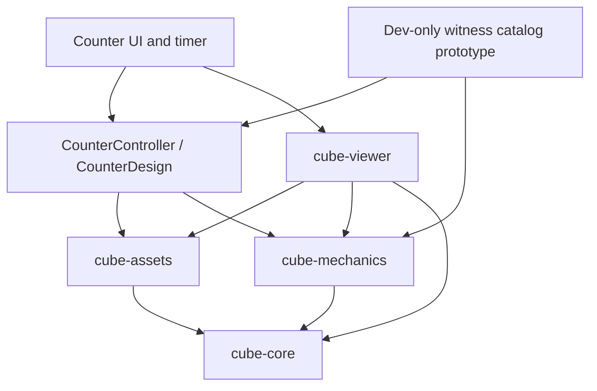

# M1 shared runtime used by the counter

This implements the executable architecture gate in [#18](https://github.com/wstein/cubistry/issues/18)
and the internal M1 portion of [#21](https://github.com/wstein/cubistry/issues/21).
It preserves the existing fixed-print construction and counter. It does not
create a hosted repository, migrate another project, or implement sizes 3–7.

## Actual packages and dependency direction

These are private npm workspaces with ReScript source ownership for the reusable
physical domain, validation, notation, mechanics and lossless JSON codec.
TypeScript retains explicit wire/interop declarations, browser image loading,
Three.js viewing and product UI. Node 24+ consumes the compiled ES modules;
Vite bundles those same modules. `npm run build:core` compiles pinned ReScript
12.3.1 before the TS/test/build commands. Generated `.res.mjs` files are versioned
for inspection and rebuilt in CI; `.res.d.mts` declarations form the explicit
checked public bridge exercised by the shared 100-witness integration tests.
There is no remaining TypeScript implementation of the shared physical engine
or pure asset-schema validator. Notation/validation/codecs begin as modules in
these packages rather than creating empty additional packages.

### Binding decision snapshot and transitional names

The [requirements snapshot](../research/architecture/requirements-puzwerk-20261027.json)
records issue #21's update at **2026-10-27T15:00:50Z** and its body digest. The
appended PuzWerk decision explicitly supersedes the earlier TypeScript-core
hypothesis. The earlier working TS prototype remains reproducible at commit
`a374b854ac313753e98a84e2b0820d7373fe61d6`; its saved M1 manifest is historical,
not a claim that it satisfied the later language requirement.

The current brand is **PuzlWerk**; the existing repository is
[`wstein/puzlwerk`](https://github.com/wstein/puzlwerk), and technical package
references use lowercase `@puzlwerk/*`. This naming does not claim publication
or authorize consumer integration. Local private `@cubistry/*` names remain
unchanged. The dated snapshot above retains its original name, URL and hash;
it is historical evidence, not the current repository naming convention.
[Issue #21](https://github.com/wstein/cubistry/issues/21) remains the architecture
source; shared-package consumption requires a separately approved migration.
No PureScript or new Rust package is
introduced. The user's name “Cube Backhaul” and the audited `wstein/cubacle`
repository are not assumed to denote the same project; that mapping must be
confirmed before any Rust changes. Existing solvers stay behind versioned
external adapters, outside the core.



`A --> B` means A imports B. Core and mechanics have no DOM, Three.js, counter,
timer, or solver dependency. The viewer has no counter value, target catalog,
queue, clock, or solver. Calling the generic viewer never invents a next state.

| Module | Executed responsibility |
| --- | --- |
| [cube-core](../packages/cube-core/res/PwCore.res) | Topology, permanent cubie/sticker/image IDs, local frames, immutable print, complete body poses, target predicates, strict schema validation |
| [cube-mechanics](../packages/cube-mechanics/res/PwMechanics.res) | One right-handed integer rotation engine, legal move parser/AST, state transitions, source poses, exact/optical target matching, legal presentation verification |
| [cube-assets schema/codec](../packages/cube-assets/res/PwAssets.res) and [browser resolver](../packages/cube-assets/src/index.ts) | Versioned asset/document metadata, safe bounded image/font loading, integrity hashes, immutable bitmaps, lossless design/state JSON references |
| [cube-viewer](../packages/cube-viewer/src/index.ts) | Camera, rigid cubie meshes, image materials, animation of an externally provided legal transition |
| [CounterController](../src/apps/counter/controller.ts) | Counter goal selection, queued desired values, witnessed paths through the common state, authoritative current physical state |
| [CounterDesign](../src/apps/counter/design.ts) | Versioned counter ingress, configuration and exact upright front goals; all 100 words checked before use |
| [Counter rules](../src/counter.mjs) | Numeric bounds and wall-clock timer, independent of cube mechanics/rendering |

The former `src/cube.mjs` and camera entry are compatibility facades. The old
facelet generator adapter delegates to the same `turnVector` implementation;
it does not maintain a second rotation engine. The former renderer file only
reexports the extracted viewer and counter artwork recipe. No throwaway
replacement application was introduced.

## Canonical physical contract

Schema families are `cubistry.print@1`, `cubistry.state@1`,
`cubistry.target@1`, `cubistry.assets@1`, `cubistry.design-state@1`, and the
product-specific `cubistry.counter-design@2`. The exact `schema` string and
integer `version` are separate JSON fields. The topology is `{kind:"cube",size:2}`.
Unknown versions, unsupported puzzle tags, stringified IDs, malformed frames,
missing asset/material references, and unsupported sizes are rejected.

The world frame is right-handed: +x right, +y up, +z front. Size-2 source
positions are the eight combinations of ±1. Body frames are proper signed
permutation matrices represented by the three source basis vectors in world
coordinates: `rotate(v,R)[i] = sum(v[j] * R[j][i])`. The complete state stores
one position and one body frame per physical cubie. Source sticker normals,
print-up vectors, and image references are immutable and transformed through
that body frame; the state does not contain a second mutable image assignment.
Camera pose is not a physical cube state.

`validateState` checks unique IDs/positions, rigid frames, source-position/body
agreement, and the size-2 corner-twist invariant. The product additionally
constructs states by explicit legal move histories. This is not advertised as
an NxN reachability checker: odd/even centers, middle edges, wing orbits and
size-specific parity rules remain future work. A target's optical predicate
may use only a declared C4 subgroup `{0}`, `{0,2}` or `{0,1,2,3}`. Actual physical
orientation is never normalized away. Counter digits/title targets demand exact
upright frames; a blank can request optical equivalence.

JSON object-key and cubie-array order do not define physical meaning. State
validation canonicalizes by cubie ID and legal-presentation comparison uses
semantic state equality. Genuinely changed poses still fail replay. The
lossless design/state JSON helper includes the source print and full asset
references/SRI, not just colors. Referenced asset blobs must accompany transport.

## Versioned design, loaded images, and bounds

The browser now loads [the actual v2 design](../public/counter-design.v2.json),
not a raw unvalidated schema-1 proof. Its two prints contain the same 24
permanent source stickers, normals and print-up frames as the original evidence.
The design references actual SVG files, the pinned WOFF2 font, materials, and
an immutable text document with two crop rectangles. A new label generates a
new immutable print-instance ID from the print and configured assets. Counting
only changes poses and never reloads or paints sticker images.

The image loader implements color, **SVG, PNG, WebP and text** definitions.
It returns read-only maps of immutable ImageBitmaps, not writable canvases.
The bitmaps are prepared for bottom-left texture upload; the viewer checks that
explicit convention and does not independently flip or repaint them.

Loading restrictions are executable, not merely recommendations:

* Root-relative static same-origin URLs only; no query/fragment, path traversal,
  encoded URL tricks, external origins, or redirects.
* SHA-256 integrity, exact media type, 256 KiB per fetched file, 4 MiB per load,
  64 entries per list, dimensions at most 1024 per side, and an 8-megapixel
  decoded-image budget. The stream is bounded even without Content-Length.
* Asset URLs carry no version or hash, so the HTTP cache may serve an older file
  at the same URL after a deploy (for example old art with new code). On a
  SHA-256 mismatch alone, the loader retries once with `cache: "reload"`, which
  skips the browser HTTP cache, refreshes its entry for later loads and asks
  intermediaries for a fresh copy (`Cache-Control: no-cache`); a CDN that
  ignores that request can still return the old file. Bytes that still differ
  fail closed with "Asset integrity check failed". The retry does not change
  URLs, pinned hashes or the budget (rejected bytes are not charged; the reload
  is charged and capped as usual). Network errors, HTTP errors, aborts and limit
  violations are never retried. Covered by `tests/asset-cache.test.mjs`.
* Fetch cancellation/deadline uses AbortSignal (10 seconds). Native font/image
  decode is bounded by validated input size; no hard CPU-preemption claim.
* SVG accepts only a bounded drawing subset. Scripts, event attributes, styles,
  links, filters, external images, foreignObject, XML/entity declarations and
  uncontrolled URLs are rejected before use.
* Text references a declared font/weight and explicit crop. Fitting reduces font
  size within its declared interval and scales `lineHeight` proportionally.
  A still-overwide label fails instead of being silently clipped.
* Temporary FontFace registrations are removed in a finally block after text
  rasterization. A later failure closes prior bitmaps; successful instances
  release bitmaps when replaced. Existing counter state survives a failed load.

## Preserved evidence and explicit adapters

The original [schema-1 witness](../public/counter-proof.json) and v1/v2/v3 proof
results are preserved. The [conversion tool](../research/architecture/build_counter_design.mjs)
checks legacy tags and converts those source frames into the shared definition.
The existing KPuzzle adapter still checks exact-frame solutions, and its
legacy geometry facade now calls the shared mechanics.

The independent [Python v2 checker](../research/architecture/verify_design.py)
imports neither ReScript/JavaScript implementation nor generator. It validates v2 tags and references, actual
asset hashes/safe SVG source, and the immutable correspondence with the original
printing. Independent metadata regressions include invalid text/material fields
and CSS-escaped SVG references in a temporary asset tree. It converts to the preserved independent facelet-replay contract and
checks all 100 values, both prints, every ordered transition by hub factorization,
and chained transitions. The current [independent result](../research/architecture/verification-m1-title-link.json)
records the hardened metadata checker and preserved design digest. The original Python checker now rejects incorrect
legacy schema/puzzle metadata as well; its new [v4 output](../research/counter/verification-v4.json)
does not overwrite the earlier outputs. The separate [ReScript M1 manifest](../research/architecture/manifest-m1-webcrypto.json)
records the current source/generated code, assets, dependency lock, checker and
evidence hashes. Both earlier counter and TypeScript-M1 manifests remain
historical snapshots tied to their recorded commits.

```sh
npm ci
npm run build:design
npm run check
CI=1 npm run test:e2e
node research/architecture/demo-services.mjs
```

`npm run check` compiles ReScript and then runs strict `tsc --noEmit`, including the executable dev
solver prototype and proposal interfaces. Vite transpilation alone is not the
type gate. Browser tests retain the old timer/label/queue regressions and add
unsupported schema/puzzle rejection, generic non-counter viewing, actual
PNG/WebP decoding, immutable image maps, text-style semantics and transactional
failure cleanup. The generic viewer demonstration uses a solid-image print
and a legal R transition without importing counter goals or witnesses.

## #21 audit, service prototype, and explicit remaining scope

The [source/license/capability audit](FRAMEWORK_SOURCE_AUDIT.md) compares all six
requested repositories at pinned revisions. The
[service/codec proposal](FRAMEWORK_SERVICE_PROPOSALS.md) and
[staged roadmap](FRAMEWORK_ROADMAP.md) separate M1, M2, M3 and both size waves.
A [machine-readable size plan](../research/architecture/proposals/size-roadmap.json)
checks only geometry counts for sizes 2–7; every non-2 runtime flag is false.

The compiling [service interfaces](../research/architecture/proposals/service-contracts.ts)
are supplemented by an **executable bounded catalog prototype**,
[not just type declarations](../research/architecture/proposals/catalog-backend.ts).
It contrasts exact completion to the full source/reference state with a known
partial counter-front goal. Both return replay-verified paths for registered
states only; general partial-image targets, unknown states, unsupported frames,
cancellation and insufficient budgets return `UNKNOWN`. It does not claim an
optimal partial-display path. Warm/preparation time is measured, cancellation
is cooperative, and memory is an explicit serialized-data estimate rather than
a hard JavaScript heap guarantee. The prototype is dev-only, outside core and
viewer; it does not replace an actual general cube solver.

Only canonical JSON roundtrip is executed in M1. Color-facelet and Orbit64
runtimes are **not integrated**, and their cross-repository conformance/roundtrip
criterion remains outstanding for M2/M3. A color array cannot losslessly encode
image-sticker identities or local up frames, and Orbit64 convention/version
names do not establish compatibility. Cubacle's existing partial color goals
also accept global rotations and cannot silently serve exact-front image goals.

All four internal packages currently use the repository's AGPL-3.0-or-later
license, retaining the reused MIT camera notice and OFL font notice. Migrating
MIT CubeAssembler to an AGPL core would require an explicit owner/license and
distribution decision; this change does not assume loose coupling is an exception.
No external repository creation, cross-repository source migration, capture,
Bluetooth integration, multi-size solver port, or claim that the entire broad
issue #21 is finished is part of this M1 implementation.
