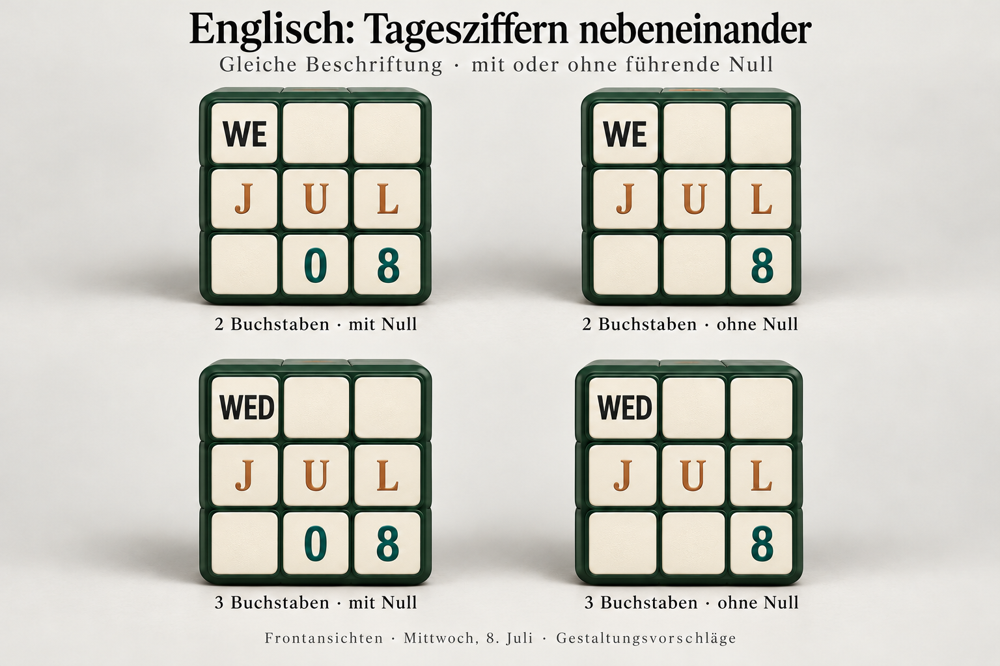
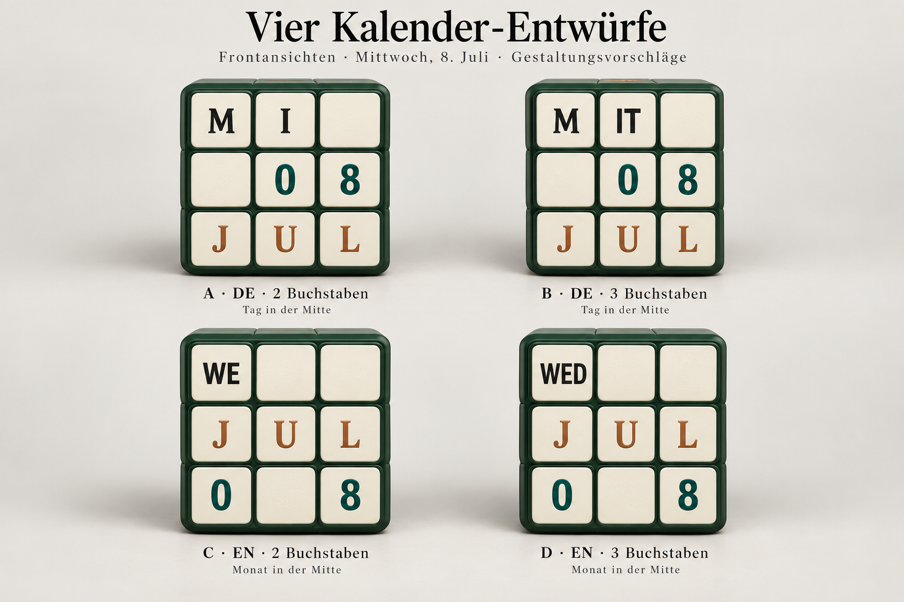
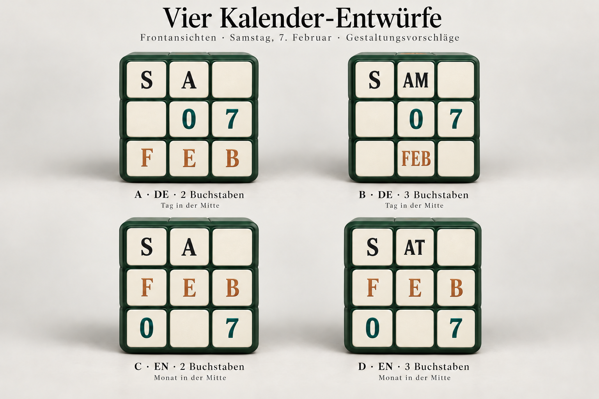

# Original 3×3 calendar cube proposals

## Current visual direction

The latest user requirements are in [model-v3.json](model-v3.json). **B is
excluded** for visual reasons; the older English split-day proposals are
superseded. The retained German candidate is A / `de-2`.

The new [English adjacent-day prints](adjacent/README.md) use a complete weekday
abbreviation on the first sticker, a uniformly three-letter middle-row month,
and adjacent lower-right day digits. **The same physical print supports both
leading-zero settings.** Two- and three-letter weekdays are separate prints.
All four formatting/width cases, covering 10,248 target states, have passed
independent physical replay.



These are generated aesthetic concepts, not final print artwork or proof images.
The original evidence and images below remain as historical context; they do
not put excluded B back into the selection.

## Earlier proposals and preserved evidence

This investigation follows the user's revised layout in [model-v2.json](model-v2.json):

- **German:** weekday above, day in the middle, month below.
- **English:** weekday above, month in the middle, day below.

Two- and three-letter weekdays are examined separately. Two-letter weekdays
start in the left column. Fixed word fragments are allowed; all nonblank
fragments and digits must be upright. Every print has 54 immutable stickers.
Blank stickers have no visible orientation. Legal operations are outer face
turns and explicit whole-cube rotations. The previously mentioned year and
weekend-color requests were withdrawn and are not included.

## Four concrete proposals



The image is an original generated **design concept**, illustrating front-cell
placement for Wednesday, July 8. It is not a photograph, final print sheet,
move certificate, or evidence of physical feasibility. It copies no artwork,
logo, or exact print from the reference photograph. Final typography and
printing assets remain separate work.

| Proposal | Language | Weekday | Middle row | Day cells | Distinct required center images |
| --- | --- | --- | --- | --- | ---: |
| A / de-2 | German | 2 letters | Day | blank, tens, units | 4 |
| B / de-3 | German | 3 letters | Day | blank, tens, units | 4 |
| C / en-2 | English | 2 letters | Month | tens, blank, units | 6 |
| D / en-3 | English | 3 letters | Month | tens, blank, units | 6 |

German uses center images `0, 1, 2, 3`, with two spare blank centers. English
uses `A, E, P, U, C, O`, precisely the six middle letters of its standard
three-letter month names. The English day digits sit on the bottom corners;
the gap between them is intentional and visible in the concept image.

The [constructive definitions](constructive/) specify the actual original
corner triples, edge pairs, center images, and word partitions. Word fragments
are structural parts of these prints, not interchangeable screen labels:

- **A:** single characters throughout the weekday and month rows; the most
  uniform character spacing of these four proposals.
- **B:** `DIE` and `FRE` occupy one weekday sticker. `FEB` and `NOV` each occupy
  the middle sticker of the month row; other months use three stickers.
- **C:** `WE` and `FR` each occupy the left weekday sticker. Month names always
  use three individual characters in the middle row.
- **D:** `MON`, `WED`, and `FRI` each occupy the left weekday sticker; the other
  weekday abbreviations use fixed fragments across the first two cells.
  Month names always use three individual characters in the middle row.

The image shows one date, so it does not expose every exceptional fragment
layout. These differences matter when judging visual consistency across a year.

The second example deliberately exposes the February exception:



Exact front-cell contents and original image hashes are in
[concepts.json](images/concepts.json). These images are proposals, not final
production typography or licensed font assets.

Integrity hashes, environment details, and the accepted artifact counts are in
[manifest.json](manifest.json).

## Calendar coverage and center orientation

Each [full witness](witnesses/) contains 2,562 displays: every weekday paired
with each of the 366 valid month/day combinations. These are exactly the
distinct visible date patterns attained in the complete Gregorian cycle
2000–2399, including February 29. Invalid dates are excluded. The four complete
candidate witnesses therefore cover 10,248 displays.

Every display has a legal whole-cube prelude, a legal outer-face sequence,
and, when needed, a legal visible-center orientation correction. All 54 sticker
identities and frames are retained. The generator has physically replayed all
targets. Independent physical replay has now accepted **all four variants as
SAT**, checking all 10,248 target states and their complete source-restoring
inverses. The independent results are retained under [independent/](independent/).
The original generator files retain their pre-review UNKNOWN labels for
provenance; independent acceptance, not that label, establishes SAT.

Ordinary 3×3 solvers ignore printed center orientation, which is insufficient
for an upright calendar. The saved [center corrections](center-corrections.json)
restore every noncenter physical frame while turning the visible center by
90, 180, or 270 degrees. They take 18, 20, and 18 HTM respectively. Hidden
center orientations are unconstrained. The corrected full words, including
whole-cube preludes, must be checked by the independent physical replayer.

## Combined language and earlier experiments

The exact center inventories of proposals A/B and C/D require ten distinct
nonblank center images together, exceeding six. Thus **these proposed prints
cannot simply be combined**. This is not a general impossibility proof for
every permitted bilingual word-fragment segmentation. That broader question
remains **UNKNOWN**.

The initial [model](model.json), [capacity screening](capacity.json),
[fragment screening](fragment-search.json), and `physical-*.json` bounded
solver runs retain earlier assumptions with the day in the middle for both
languages. They are historical experiments superseded by the user's revised
English row order. Their qualified single-character bounds do not exclude
current word-fragment proposals. The bounded Z3 runs timed out with UNKNOWN;
inventory-only MILP candidates were never treated as physical SAT.

## Reproduction

Node.js 24 and the locked `cubing` 0.66.1 dependency generate legal words. The
independent verifier uses standard-library Python and must not import the
generator or its geometry.

```sh
cd research/date-3x3
npm ci
cd ../..
python3 research/date-3x3/construct-layouts.py /tmp/calendar-candidates-new
node research/date-3x3/generate-witness.mjs research/date-3x3/constructive/de-2.json NEW_OUTPUT_PATH
python3 research/date-3x3/verify_witness.py research/date-3x3/witnesses/de-2.json
python3 -m unittest discover -s research/date-3x3 -p 'test_*.py' -v
```

Repeat with `de-3`, `en-2`, or `en-3`. The output path must not exist.
`construct-layouts.py` recreates the original candidate definitions into a new
directory; it deliberately refuses to overwrite retained candidates. The
optional early screening scripts require SciPy 1.17.0, NumPy 2.3.5, or
z3-solver 4.15.3.0; these dependencies are not needed to check legal witnesses.

## Limits and next design decision

These are existence witnesses, not globally optimal prints or shortest daily
transitions. Their source-to-display sequences are not average consecutive-day
costs. The five-move bound proved for the separate 2×2 H/S/M counter does not
apply to this 3×3 calendar. No application, deployment, physical print output,
red-weekend styling, or year display is implemented here.

Visual preference should consider every weekday and month, not only the sample
image. A favors regular single-letter rows; D gives the clearest three-letter
English labels, with fragment-dependent spacing. Daily move optimization and
production typography should follow selection of a layout.
